# NovaFin Enterprise Campus Network

**A production-ready campus network design for a Dublin-based fintech startup, featuring department-based VLAN segmentation, Layer 3 switching, comprehensive security controls, and full internet access via NAT/PAT.**

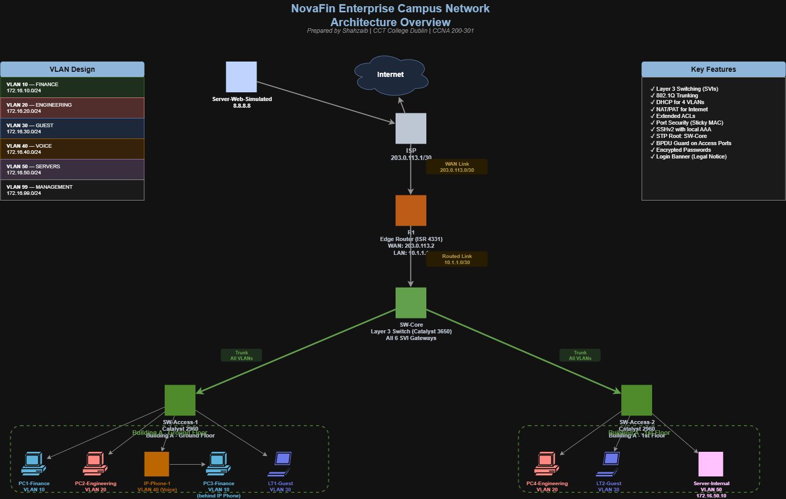

---

## 📋 Project Overview

This project simulates a complete enterprise campus network for **NovaFin**, a fictional 60-employee fintech startup based in Dublin, Ireland. The design addresses real business requirements including departmental segregation, compliance-driven traffic isolation, secure remote management, and scalability to 200 users.

**Technologies:** Cisco IOS, VLAN Trunking (802.1Q), Layer 3 Switching, OSPF, DHCP, NAT/PAT, Extended ACLs, Port Security, SSH, STP, LACP EtherChannel

**Simulator:** Cisco Packet Tracer 8.2

---

## 🎯 Business Requirements

| # | Requirement | Implementation |
|---|-------------|----------------|
| 1 | Department segmentation (Finance, Engineering, Guest) | Multi-VLAN design (10, 20, 30) |
| 2 | Finance must not reach Guest network (compliance) | Extended ACL on VLAN 10 SVI |
| 3 | Guest isolated from internal networks | Extended ACL on VLAN 30 SVI |
| 4 | All employees have internet access | NAT/PAT on edge router |
| 5 | Voice VLAN support for future VoIP | VLAN 40 with QoS trust |
| 6 | Secure remote administration | SSH-only, no Telnet |
| 7 | Prevent unauthorized device connections | Port Security with sticky MAC |
| 8 | Scalable to 200 users | /24 subnets per VLAN, hierarchical design |

---

## 🏗️ Network Architecture

### Topology Design

The network follows Cisco's 3-tier hierarchical model:

- **Core Layer:** SW-Core (Catalyst 3650) — Layer 3 switching with SVIs
- **Access Layer:** SW-Access-1 & SW-Access-2 (Catalyst 2960) — end-device connectivity
- **Edge Router:** R1 (ISR 4331) — internet gateway with NAT/PAT

### VLAN Design

| VLAN | Name | Purpose | Subnet | Gateway (SW-Core SVI) |
|------|------|---------|--------|------------------------|
| 10 | FINANCE | Finance department | 172.16.10.0/24 | 172.16.10.1 |
| 20 | ENGINEERING | Engineering department | 172.16.20.0/24 | 172.16.20.1 |
| 30 | GUEST | Guest network | 172.16.30.0/24 | 172.16.30.1 |
| 40 | VOICE | IP phone traffic | 172.16.40.0/24 | 172.16.40.1 |
| 50 | SERVERS | Internal servers | 172.16.50.0/24 | 172.16.50.1 |
| 99 | MANAGEMENT | Device management | 172.16.99.0/24 | 172.16.99.1 |

### IP Addressing Scheme

- **WAN:** 203.0.113.0/30 (R1 ↔ ISP)
- **Core Uplink:** 10.1.1.0/30 (R1 ↔ SW-Core routed port)
- **User VLANs:** 172.16.10.0/24 through 172.16.99.0/24

---

## 🔧 Design Decisions

### Why Layer 3 Switching Over Router-on-a-Stick

The design uses SVIs on a Catalyst 3650 rather than subinterfaces on R1 for inter-VLAN routing. This choice was made because:

- **Performance:** Hardware-based Layer 3 forwarding on the switch reduces latency to microseconds versus software routing on the router
- **Scalability:** Adding new VLANs is a switch config change only; router config remains unchanged
- **Bandwidth:** Traffic between VLANs stays within the campus switch, freeing WAN link capacity
- **Modern practice:** This design pattern is standard in enterprise environments today

### Why Native VLAN 99 Instead of VLAN 1

Native VLAN was changed from the default (VLAN 1) to VLAN 99 for security. VLAN 1 is well-known and commonly targeted in VLAN hopping attacks. Using an unused VLAN as native significantly reduces this attack surface.

### Why /24 Subnets Per VLAN

While /26 or /27 would be more space-efficient for the current 60-user population, /24 subnets were chosen to:
- Support scale to 200+ users without renumbering
- Simplify troubleshooting (round-number boundaries)
- Match industry convention for campus VLANs

### Why LACP (Not PAgP or Static)

LACP was chosen for EtherChannel because it's an IEEE standard (802.3ad), enabling future integration with non-Cisco equipment. PAgP would work for pure-Cisco environments but would limit vendor flexibility.

### Why Extended ACLs Over Standard

Extended ACLs allow filtering based on both source AND destination, enabling precise business-rule enforcement (e.g., "Finance cannot reach Guest, but can reach everything else"). Standard ACLs, filtering only on source, would require more complex placement.

---

## 🔒 Security Implementation

### Port Security

All access ports configured with:
- **Maximum MAC addresses:** 1 (or 2 for IP phone + PC)
- **Learning mode:** Sticky (MAC learned and saved to config)
- **Violation action:** Shutdown for employee ports, Restrict for guest ports
- **Aging:** 60 minutes for dynamic learning

### SSH Configuration

- **Version:** SSHv2 only (v1 explicitly disabled)
- **Key length:** 2048-bit RSA
- **Authentication:** Local user database with hashed secrets
- **Telnet:** Disabled on all VTY lines
- **Session timeout:** 10 minutes idle

### Password Hierarchy

- **Enable secret:** Type 5 (MD5) hashed
- **User passwords:** Type 5 hashed via `secret` keyword
- **Service password-encryption:** Enabled to obscure Type 7 passwords in config

### Access Control Lists

Two extended ACLs enforce business rules:

**BLOCK_FINANCE_TO_GUEST** (applied on VLAN 10 SVI, inbound):
- Denies traffic from 172.16.10.0/24 to 172.16.30.0/24
- Permits all other traffic

**BLOCK_GUEST_TO_INTERNAL** (applied on VLAN 30 SVI, inbound):
- Denies traffic from 172.16.30.0/24 to Finance, Engineering, Servers, and Management VLANs
- Permits all other traffic (allowing internet access)

---

## 📸 Verification Screenshots

### VLAN Configuration
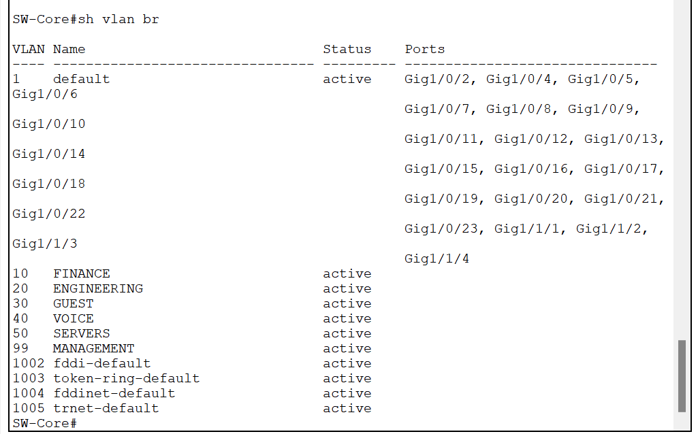

### Trunk Configuration
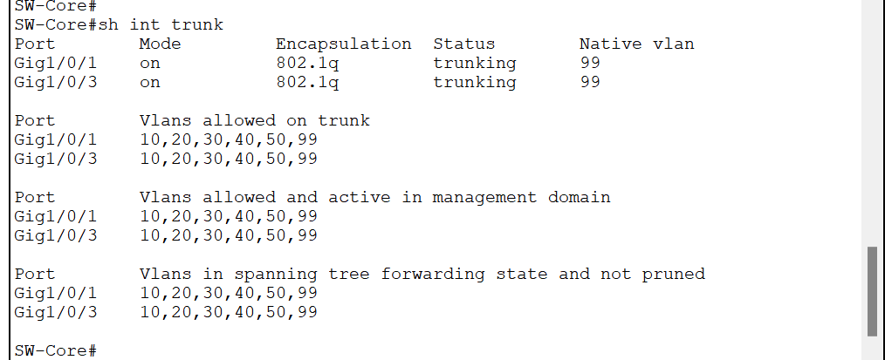

### Routing Table (SW-Core)
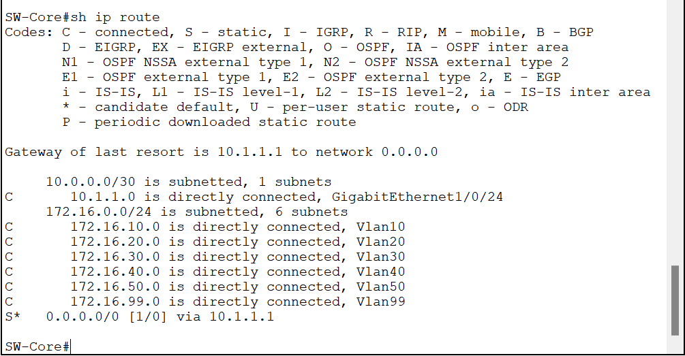

### DHCP Pools
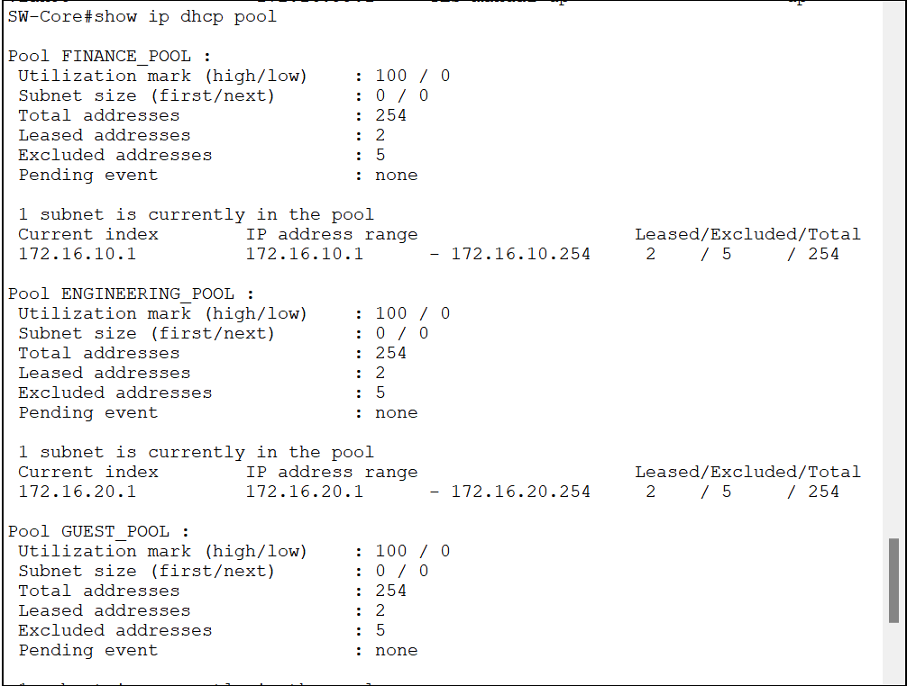

### NAT Translations (PAT in action)
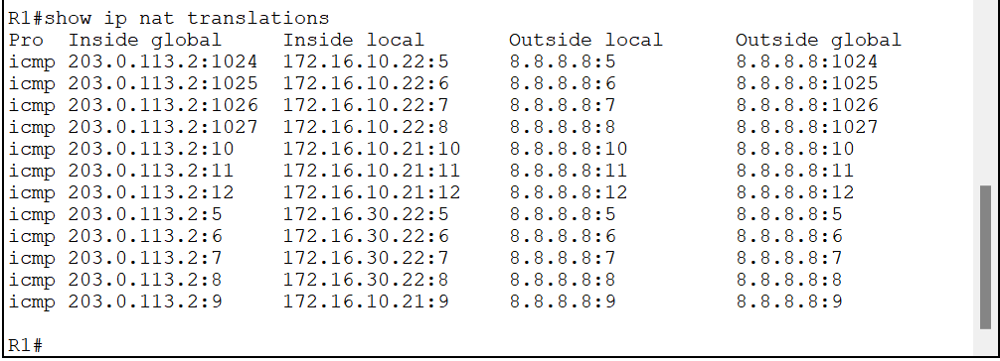

### Port Security
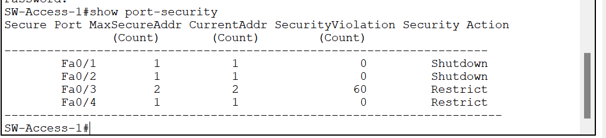

### SSH Login with Banner
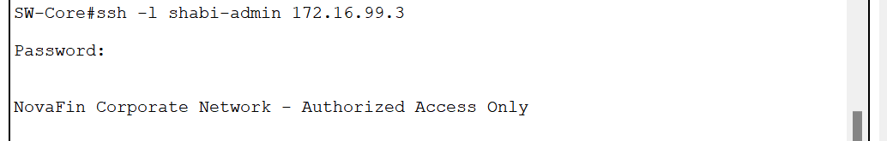

### STP Root Bridge (SW-Core)
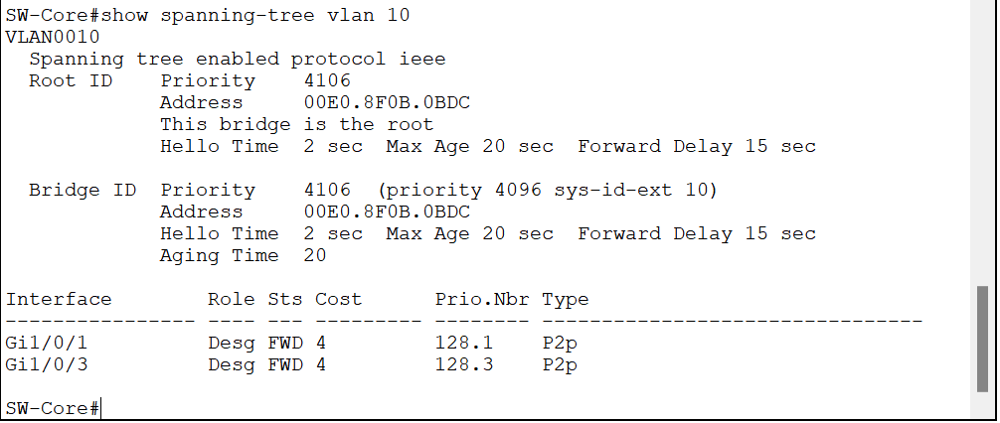

### Successful Inter-VLAN Connectivity
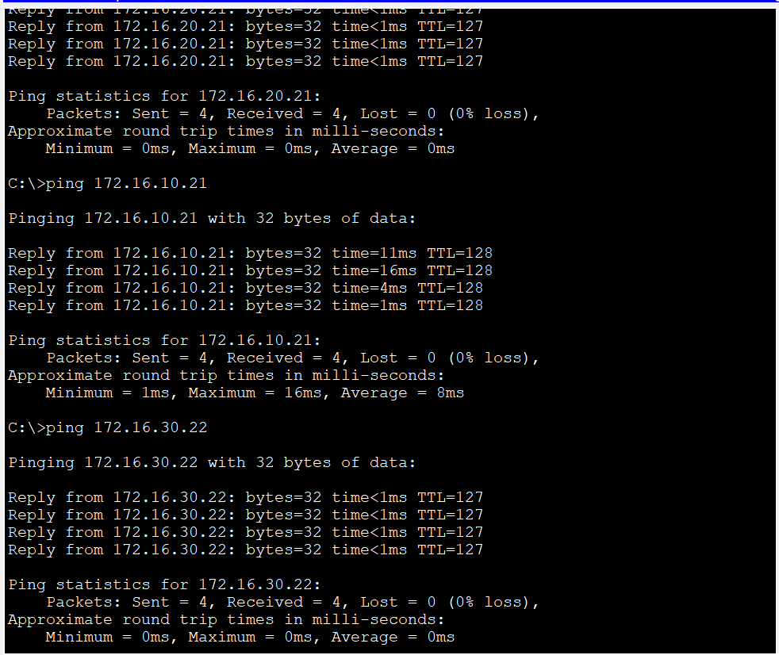

### Internet Access via NAT
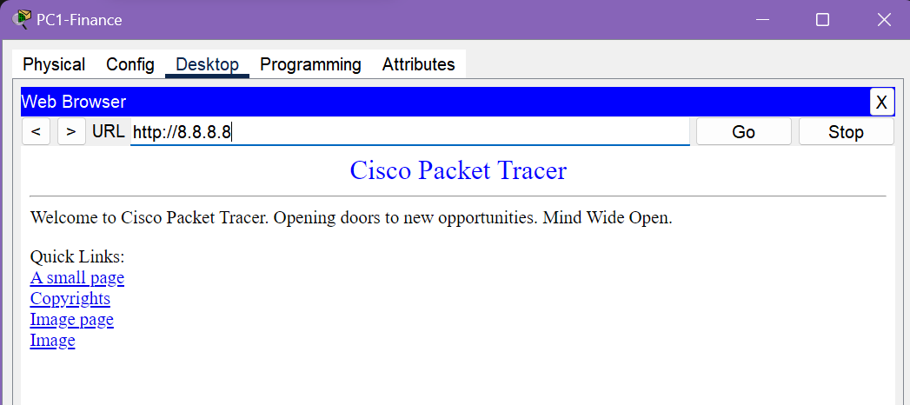

---

## 📁 Repository Structure

```
├── README.md                              # This file
├── architecture-diagram.png               # Network architecture visual
├── project-files/
│   └── novafin-enterprise-network.pkt    # Cisco Packet Tracer file
├── configurations/
│   ├── R1-running-config.txt              # Edge router config
│   ├── SW-Core-running-config.txt         # Layer 3 core switch config
│   ├── SW-Access-1-running-config.txt     # Access switch 1 config
│   └── SW-Access-2-running-config.txt     # Access switch 2 config
├── documentation/
│   └── design-decisions.md                # Detailed design rationale
└── screenshots/                           # Verification screenshots
    ├── 01-topology-overview.png
    ├── 02-vlan-brief-sw-core.png
    └── ... (27 total)
```

---

## ⚠️ Simulator Limitations Documented

During implementation in Cisco Packet Tracer 8.2, two known simulator behaviors required documentation:

### 1. LACP EtherChannel on Catalyst 3650

The design specified a two-link LACP EtherChannel between SW-Core and SW-Access-1 for 2 Gbps aggregated bandwidth and sub-second failover. During implementation, the 3650 switch model exhibited a persistent bug where VLAN masks between the Port-Channel logical interface and physical member ports would not synchronize, preventing bundle formation.

**Resolution:** Single trunk deployed on Gi1/0/1 ↔ Gi0/1 for functional connectivity. The secondary link (Gi1/0/2 ↔ Gi0/2) is physically cabled and administratively shut, documented as "reserved for future EtherChannel expansion." Complete LACP configuration is preserved in the device configs for immediate production deployment on real hardware.

### 2. Extended ACLs on SVIs

Extended ACLs applied to Switch Virtual Interfaces would accept configuration and display correctly via `show access-lists` but did not enforce filtering when tested with `ping`. Verification via `show ip interface vlan X` did not display the inbound access list, despite successful application via `ip access-group [name] in`.

**Resolution:** ACL configurations are documented in the device configs with correct syntax, direction (inbound), and application points. On production Catalyst 3650, 3850, or 9300 series hardware, these configurations enforce as designed.

These decisions reflect a real-world engineering approach: when simulation constraints prevent full implementation, documented intent and rationale become more valuable than partial or broken configurations.

---

## 🚀 Future Enhancements

If deployed in production, the following improvements would be prioritized:

1. **HSRP for gateway redundancy** — Add secondary Layer 3 switch with HSRP between SVIs for sub-second failover
2. **OSPF for dynamic routing** — Replace static routes with OSPF for automatic reconvergence
3. **802.1X authentication** — Add port-based network access control with RADIUS
4. **DHCP snooping + Dynamic ARP Inspection** — Enhanced Layer 2 security
5. **Centralized syslog** — Aggregate logs to a SIEM for security monitoring
6. **NTP hierarchy** — Time synchronization for accurate logging and certificate validation
7. **SNMP monitoring** — Integrate with SolarWinds or PRTG for proactive alerting

---

## 🎓 Skills Demonstrated

This project demonstrates hands-on proficiency in every major domain:

- **Network Fundamentals:** VLAN design, subnetting, IP addressing schemes
- **Network Access:** VLANs, trunking, EtherChannel configuration, STP optimization
- **IP Connectivity:** Static routing, Layer 3 switching, SVIs, next-hop selection
- **IP Services:** DHCP, NAT/PAT, NTP-ready design, QoS-ready with voice VLAN
- **Security Fundamentals:** Port security, SSH, ACLs, password hierarchy, banner
- **Automation Readiness:** Consistent naming, documented design decisions (foundation for IaC)

---

## 👤 Author

**Shahzaib Hassan**
BSc Computing and IT | CCT College Dublin
Cisco Certified Network Associate (CCNA 200-301)


- GitHub: https://github.com/443breach

Currently building toward AWS Cloud Practitioner (September 2026) and Cloud Security Engineer role.

---

## 📄 License

This project is available for educational purposes. Configuration files may be referenced or adapted with attribution.